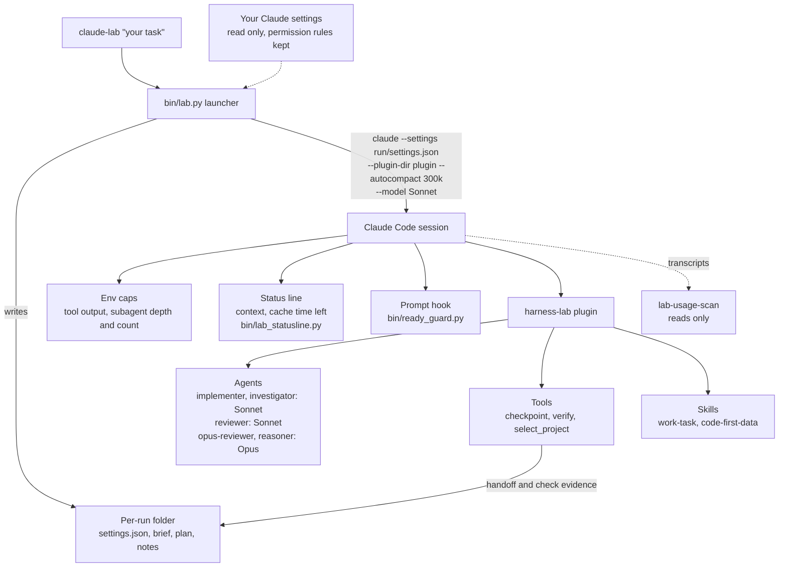

# claude-lab

[](LICENSE)
[](https://github.com/mahimn01/claude-lab/stargazers)
[](https://github.com/mahimn01/claude-lab/commits/main)

**Run [Claude Code](https://docs.claude.com/en/docs/claude-code) with settings tuned to use fewer tokens, without touching your normal `claude` setup.**

Why you might want it:

- **Smaller, cheaper by default.** A 300k context cap, Sonnet as the lead model with Opus kept for financial or security-sensitive reviews and the reasoner agent, capped tool output, and fewer idle tools in the prompt.
- **See where your tokens go.** A status line shows context size and prompt-cache time left; `lab-usage-scan` reads your own transcripts and shows which tools and models use the most.
- **Opt-in and reversible.** It is a thin launcher. It does not patch Claude Code and does not edit your Claude settings. Plain `claude` keeps working exactly as before; only sessions started with `claude-lab` get the tuned setup.

### Quick start (about 20 seconds)

You need Python 3.10+, git and Claude Code (`claude`) on your PATH.

```
git clone https://github.com/mahimn01/claude-lab && cd claude-lab
scripts/install.sh              # symlinks into ~/.local/bin; edits nothing else
claude-lab doctor               # check Claude Code and where lab state will live
claude-lab --dry-run            # print the exact command and settings; starts nothing
claude-lab                      # start a tuned interactive session in the current folder
```

### What it looks like

Real output from this repo on Linux (abridged; paths shortened). None of these commands calls a model.

```
$ claude-lab doctor
{
  "claude": "2.1.197 (Claude Code)",
  "baseline": "none yet: run `claude-lab doctor save`",
  "lab_plugin": "~/claude-lab/plugin"
}

$ claude-lab --dry-run
would start (nothing launched, no model call):
~/.local/bin/claude \
  --setting-sources project,local \
  --settings /tmp/claude-lab-preview-xxxx/settings.json \
  --plugin-dir ~/claude-lab/plugin \
  --model claude-sonnet-5-5 \
  --autocompact 300k \
  --append-system-prompt [scoped instructions and lab workflow] \
  --name Claude Lab balanced \
  --session-id 8f35c117-1c73-4621-8ca5-ee4280604a5d

$ claude-lab route "fix the failing test in totals.py"
{"model":"claude-sonnet-5-5","effort":"medium","reason":"default route","financial":false,"hard":false}
```

> Honest note: the savings below come from how the settings work (smaller context, cheaper default model,
> fewer idle tools, less tool output). They are reasoned, and each one is a setting you can read in
> `bin/lab.py`. A small measured comparison is in [Measured results](#measured-results) further down, with its
> limits stated; it does not show the lab being cheaper on larger tasks. To measure on your own work, use
> `claude-lab benchmark` and `lab-usage-scan` (both described below). Nothing here calls a model unless you
> start a session.

### How it fits together



Plain `claude` never goes through any of this. There is also an optional tmux and git-worktree runner for up to four parallel sessions; see
[Parallel session runner](#parallel-session-runner-optional).

## What you get

| Optimization | What it does | Why it saves tokens or money |
|---|---|---|
| Context cap and compaction | Starts Claude with `--autocompact 300k` | Every message re-reads the whole context. A smaller ceiling means each call re-reads less, and compaction runs before the context gets huge. A window you set yourself (`CLAUDE_CODE_AUTO_COMPACT_WINDOW`) wins. |
| Sonnet by default, Opus on purpose | Lead model is Sonnet. Opus is used only by the `reasoner` and `opus-reviewer` agents, and by the `reviewer` on financial or security-sensitive tasks or when the lead explicitly asks for it. There is no default `advisorModel` (opt in with `CLAUDE_LAB_ADVISOR_MODEL=opus`) | Sonnet costs much less per token. Opus is spent only where a second, stronger opinion matters. The lead model is fixed for a task, because switching models in a session rebuilds the prompt cache. |
| Effort routing | `modelSettings`: Sonnet at medium effort, Opus at high | Less hidden thinking on routine work. |
| Subagent limits | `implementer` and `investigator` pin `model: sonnet` in their own files, and the plugin hook overrides any `model` argument the lead passes. `CLAUDE_CODE_SUBAGENT_MODEL` is also set, but since Claude Code 2.1.251 it is only a default, so it is not relied on. Spawn depth 1, no forked history, at most 4 at once | Subagents each carry their own context. Limiting depth, count and history stops cost multiplying. |
| Cap on tool output | `MAX_MCP_OUTPUT_TOKENS=8000`, `bashOutputMaxChars=15000` | Huge tool results sit in the context for the rest of the session. A cap keeps them small. |
| Fewer tools and skills in the prompt | 15 rarely used built-in tools are hidden; 23 skills become "user-invocable-only" (still available as `/name`) | Tool and skill descriptions are sent on every request. The source notes one of the hidden tools alone cost about 10k tokens per interactive request. `--full-tools` turns this off. |
| No background surprises | Auto-updater off, memory writes off, prompt suggestions off, goal check-ins off, cron/wakeup/remote-trigger tools hidden | Removes model calls you did not ask for. |
| Quiet sessions | Only the safety hooks you name are carried over (`CLAUDE_LAB_KEEP_HOOKS`); noisy plugins can be left out (`CLAUDE_LAB_DISABLE_PLUGINS`) | Less startup text and fewer injected messages. |
| Status line | Shows context size, prompt-cache time left, compactions and plan usage, with plain-word warnings | The costly moments are a cache miss (the whole context is re-sent at full price) and a bloated or repeatedly compacted context. The bar tells you when to start fresh. It never pings the model to keep the cache warm. |
| Plugin agents | `implementer` (Sonnet, medium effort), `investigator` (low effort, no project notes), `reviewer` (Sonnet, high effort, spawned on the full-handoff path), `opus-reviewer` and `reasoner` (Opus, high effort; the Opus reviewer for financial or security-sensitive work or on request, the reasoner for a hard question) | Each job gets the cheapest setup that fits it. Reviews come from a separate agent that did not write the code. |
| Task workflow and budget | A short workflow prompt with a small-change fast path: a change of at most 3 source files and about 80 changed lines that is not financial or security-sensitive is done by the lead alone, with no checkpoint, worker or reviewer. Larger or riskier work uses at most 4 workers, 1 review plus 1 re-review, and stops to ask at about 2M tokens | The budget is soft. It guides and never blocks. The limits are `CLAUDE_LAB_SMALL_FILES` and `CLAUDE_LAB_SMALL_LINES`. The size is measured against the source as it was when the task started; when it cannot be measured the full handoff applies. The trade-off: on the fast path the lab records no verification evidence, so the lead's own test run is the only check. |
| Handoff files | A checkpoint tool writes brief, plan, context and verification notes outside your project | At a task boundary you start fresh and read about 6000 characters of notes instead of dragging the whole conversation along. |
| Checked results | Acceptance checks run as plain argument lists (no shell, an allowed-program list, 60 second timeout), keyed to a fingerprint of your source. Code changes above the small-change limit, and all financial or security-sensitive work, need an independent reviewer approval | Fewer "it works" claims that do not hold, which means fewer expensive correction rounds. |
| Guarded data work | A `code-first-data` skill tells Claude to process bulk data with a script and return a summary | Raw dumps in the context are the most common token sink. |
| Usage scan | `lab-usage-scan` reads your own Claude transcripts and reports model split and which tools produce the most output | Shows where your tokens really go, so you can change habits or settings. |
| Account fallback (optional) | If you configure a second login, a supervisor can switch accounts at an idle moment when the first hits its limit | Keeps long work moving. Off unless you run `claude-lab auth fallback`. |
| bili proxy (optional, experimental) | Folds old conversation into summaries through a local proxy | **Off by default and not recommended without measuring.** See [docs/bili.md](docs/bili.md). |

## Install

You need Python 3.10 or newer, git, and Claude Code (`claude`) on your PATH. Node is needed for the plugin
hooks. `tmux` is only needed for the parallel runner.

```
git clone https://github.com/mahimn01/claude-lab
cd claude-lab
scripts/install.sh          # symlinks claude-lab, lab-usage-scan, claude-lab-sessions into ~/.local/bin
claude-lab doctor           # checks Claude Code and where lab state will live
```

`scripts/install.sh --prefix DIR` installs somewhere else. It never edits your Claude settings and does not
overwrite an existing command unless you pass `--force`.

Model ids are pinned in `bin/lab.py`. If your Claude Code uses other ids, set `CLAUDE_LAB_SONNET` and
`CLAUDE_LAB_OPUS`. The plugin tests need a Claude Code that has the `claude plugin test` command.

## Usage

```
claude-lab --dry-run             # print the exact command and settings; starts nothing, no model call
claude-lab demo --dry-run        # same, for the bundled demo project
claude-lab                       # start an interactive tuned session in the current folder
claude-lab "fix the failing test in parser.py"
claude-lab --mode deep "refactor the importer"
claude-lab --model opus          # use Opus as the lead for this session
claude-lab --full-tools          # undo the tool and skill cuts for this session
claude-lab doctor save           # remember a hash of your Claude config; doctor then reports if it ever changes
```

Everything the launcher writes goes under `~/.local/state/claude-lab` (run folders) and
`~/.config/claude-lab`. Both can be moved with `CLAUDE_LAB_STATE_DIR` and `CLAUDE_LAB_CONFIG_DIR`.
For defaults you always want, put `KEY=VALUE` lines in `~/.config/claude-lab/env`.

Other commands:

| Command | Use |
|---|---|
| `claude-lab route "task text"` | Show which model the rule-based router would pick. No model call. |
| `claude-lab report [run]` | Token counts for a run and an API-price estimate (an estimate, not your bill or your allowance). |
| `claude-lab benchmark` | Makes two identical copies of the demo project so you can compare plain `claude` and `claude-lab` on the same task yourself. |
| `claude-lab rate --run DIR --quality 0-5` | Record how a run went. |
| `claude-lab auth set\|status\|fallback\|primary\|clear` | Optional lab-only login token (see Security). |
| `lab-usage-scan [--since DATE] [--json]` | Where your tokens and tool output go, split into lab and normal sessions. Reads transcripts only. |

### Settings you can change (environment variables)

`CLAUDE_LAB_STATE_DIR`, `CLAUDE_LAB_CONFIG_DIR`, `CLAUDE_LAB_CLAUDE` (path to `claude`),
`CLAUDE_LAB_SONNET`, `CLAUDE_LAB_OPUS`, `CLAUDE_LAB_SOURCE_SETTINGS` (the settings file the lab starts from,
default `~/.claude/settings.json`), `CLAUDE_LAB_KEEP_HOOKS`, `CLAUDE_LAB_DISABLE_PLUGINS`,
`CLAUDE_LAB_MCPORTER_BLOCK`, `CLAUDE_LAB_FINANCIAL_TERMS`, `CLAUDE_LAB_CORE_HEADINGS`,
`CLAUDE_LAB_POLICY_HEADINGS`, `CLAUDE_LAB_TOKEN_FILE`, `CLAUDE_LAB_TOKEN_BACKEND`, `CLAUDE_LAB_PROTECT`,
`CLAUDE_LAB_DATA_DIR`. Each one is documented next to its use in `bin/lab.py`.

## How it works

`claude-lab` writes a per-run folder, then starts `claude` with `--setting-sources project,local` (or none,
for a launch in your home folder), `--settings <run>/settings.json`, `--plugin-dir plugin`, the pinned lead
model, the compaction cap, an appended system prompt, and a fixed session id. The generated settings keep
every permission rule from your own settings and add to them: they never remove one.

The bundled plugin (`plugin/`, named `harness-lab`) adds the four agents, a rule-based router, the task
budget, the checks and the data skill. The router is plain code, not a model: Sonnet by default, a hint to
try the `reasoner` only when the wording of the task looks hard and your own attempt leaves a question open. Tasks that look financial (brokerage,
orders, options and similar, plus any terms you add) are routed to higher effort, get a scoped policy text and
need a review. This is a guard rail, not a guarantee.

## Parallel session runner (optional)

`parallel/` holds a separate tool, `claude-lab-sessions`, for running several Claude Code sessions side by side.
`claude-lab start|list|count|status|tail|nudge|kill|protected` forward to it, so one command covers both.

- At most **4** sessions at once. `LAB_MAX_SESSIONS` can lower the cap, never raise it.
- Each session is a tmux session named `rt-<name>` (prefix configurable) in its own git worktree and branch.
  The runner only ever touches sessions with that prefix, and refuses names you list as protected.
- Claude runs with `--permission-mode acceptEdits` and the allow and deny list in
  `parallel/config/settings.template.json`. It never uses `--dangerously-skip-permissions`. A command outside
  the allow list makes the session wait, and `list` shows `WAITING-PERMISSION`.
- **Safety rules, enforced by settings and git hooks:** pull requests are drafts only, a human merges; no push
  to the main branch; no force-push; no `reset --hard`; no changes to git config; no reading token files or
  dumping the environment. Treat these as strong defaults, not a security boundary: a determined model or a
  loose allow list can still do damage, so review the list before you use it on real work.
- **Authorship rule:** every commit must be authored and committed by the repository owner only. No
  `Co-Authored-By` lines, no "Generated with" footers. `hooks/commit-msg` and `hooks/pre-push` run
  `scripts/check-authorship.sh`; install them in any repo with `scripts/install-hooks.sh <repo>`.
- A model router picks Sonnet for `--kind work` and Opus for `--kind review`.

```
cp parallel/.env.example parallel/.env     # set LAB_REPO_URL and the author identity
parallel/scripts/init-repo.sh              # clones your repository into parallel/repo
parallel/launch.sh fix-parser - parallel/prompts/implement-ticket.md --set TICKET=123
claude-lab list                            # see the sessions and their state
```

`launch.sh` makes the worktree, fills the `{{PLACEHOLDERS}}` in the prompt, and starts the session.
By default it pre-accepts Claude Code's first-run and folder-trust prompts for that worktree by editing
`~/.claude.json`; set `LAB_PREACCEPT_TRUST=0` to skip that. `claude-headless` is an optional wrapper that
runs `claude` with a long-lived token read from a `0600` file.

## Security

- The lab never reads, changes or copies your saved Claude login. An optional lab-only token (`claude-lab auth set`)
  is kept in the macOS Keychain on a Mac, and in private `0600` files under `~/.config/claude-lab/tokens`
  elsewhere. `CLAUDE_LAB_TOKEN_FILE` points at one shared token file the lab reads and never writes or deletes.
  Loose file permissions are refused.
- Tokens are put into the child process environment in memory, not on a command line.
- Run state is created with private permissions. Obvious secrets are redacted from recorded notes.
- `scripts/scan-secrets.sh` scans the tracked files for token and key patterns and personal paths. Run it
  before you push.

## Measured results

One box, one date (2026-10-26), Claude Code 2.1.310 for both arms, synthetic tasks, small samples. Plain = `claude -p` with the
account's default model (Sonnet). Lab = this repo's launcher. Cost is `total_cost_usd` as Claude Code printed it (API list price
equivalent, not a bill). Pass = the project's visible tests, and a hidden test the agent never saw. Harness, tasks and every summary
file are in [`benchmarks/`](benchmarks/); the tables can be recomputed from them without a model call.

**Small tasks** (3 tasks, 3 runs per arm and task; each is a few lines to change, so the fast path applies):

| | Lab cost / run | Lab wall | Plain cost / run | Plain wall | Opus used |
|---|---|---|---|---|---|
| Before the helper-model fix | $0.274 | 78 s | $0.036 | 10 s | 59-69% of lab cost |
| After (fast path, helpers pinned) | $0.040 | 15 s | $0.039 | 11 s | none |

Hidden-test passes were the same in both arms after the fix (8/9 each; one t2 test encodes one reading of an ambiguous spec).
With the fast path the lab does the work itself, so it behaves like a plain Sonnet run here; it is not cheaper than plain.
These small tasks were not re-run after the later reviewer change, because it does not touch the fast path.

**Larger tasks** (2 tasks, about 70 and 110 added source lines across several files; these need the full checkpoint, verify and
independent-review path). Means over all runs of both tasks:

| | Runs | Lab cost / run | Lab wall | Plain cost / run | Plain wall | Lab cost vs plain | Opus share of lab cost | Hidden passes (lab / plain) |
|---|---|---|---|---|---|---|---|---|
| Reviewer on Opus | 4 lab, 4 plain | $0.71 | 235 s | $0.17 | 59 s | 4.1x | 64-65% | 2/4 / 3/4 |
| Reviewer on Sonnet (current) | 6 lab, 6 plain | $0.45 | 285 s | $0.14 | 61 s | 3.2x | 0% (financial and security-sensitive reviews still use Opus) | 5/6 / 3/6 |

By task (current reviewer): l1 lab $0.31 and 131 s vs plain $0.11 and 45 s, both 3/3 on hidden tests; l2 lab $0.60 and 440 s (one
run took 749 s) vs plain $0.17 and 76 s, hidden tests 2/3 vs 0/3. Every larger lab run used 1 to 3 `harness-lab:reviewer` subagents;
that review is where most of the extra cost and time goes.

How to read this: on larger tasks the lab still costs about three times plain and takes several times longer in these runs. Moving
the reviewer from Opus to Sonnet cut the lab's cost per run by roughly a third, but did not close the gap. The hidden-test counts
differ slightly in the lab's favour (l2: plain failed the same assertion in all runs, joining a list that contained `None`, and the
lab passed it in 2 of 3 current runs but 0 of 2 earlier ones), which at these sample sizes is not a significant difference. The
lab's review is an extra check, not a measured quality gain, and its price is visible above.

Caveats: synthetic tasks written for this test, 2 to 3 runs per cell, one machine, one date, one account, interleaved sequential
runs with no control for model-side variance (one l2 lab run took 749 s). l1's hidden test had one assertion the task text did not
specify; it was removed after the first lab runs, all l1 results here are graded without it, and the original is kept as
`benchmarks/tasks/l1-ledger/hidden_test.original.py`. Total benchmark spend for the current section was about $3.6, plus about $0.15 for two model-split probes. Do not read
any of this as a general saving figure.

Reproduce:

    export CLAUDE_BIN=$(command -v claude) BENCH_OUT=/tmp/lab-bench
    for n in 1 2 3; do for task in l1-ledger l2-tpl; do
      for arm in plain lab; do python3 benchmarks/run.py $arm $task $n; done; done; done
    python3 benchmarks/summarize.py /tmp/lab-bench        # or: benchmarks/results/sonnet-reviewer

## Limitations

- Needs a recent Claude Code. Settings keys the lab writes may be ignored by older versions.
- The model ids are pinned and will go stale. Override them with the environment variables above.
- The savings are not measured here. Hidden tools and a lower effort level can also make Claude less capable
  on tasks that need them; use `--full-tools` or `--model opus` when that happens.
- The status line's "cache time left" is an estimate from transcript timestamps.
- bili is experimental and off by default; read [docs/bili.md](docs/bili.md).
- The parallel runner needs tmux and git. It was built for Linux and macOS and is not tested on Windows.
- The tests never call a model, so they cannot show how Claude behaves under these settings.

## Tests

```
scripts/run-tests.sh
```

runs everything that needs no model and no network:

- Python tests in `tests/` (launcher settings, token store, dispatcher, status line, usage scan, account
  fallback) with `pytest` or `unittest`;
- `tests/test-authorship.sh`: the commit-msg and pre-push hooks and the authorship check, in a throwaway repo;
- `tests/test-parallel.sh`: the session runner with `--dry-run` on a private tmux socket;
- the plugin tests (`claude plugin test plugin`), skipped when your Claude Code lacks that command;
- the secret scan.

## Layout

```
bin/            claude-lab (command), lab.py (launcher), token_store.py, bili_proxy.py,
                lab_statusline.py, lab-usage-scan, fallback.py, accounts.py, ready_guard.py
plugin/         the harness-lab plugin: agents, hooks, skills, tests
references/     the task-workflow prompt
demo-project/   a tiny project with a bug, for dry runs and benchmarks
benchmarks/     synthetic tasks, the plain-vs-lab run harness, and the summary files behind the results above
parallel/       optional tmux + worktree session runner
hooks/          authorship hooks (commit-msg, pre-push)
scripts/        install, run-tests, scan-secrets, check-authorship, install-hooks
docs/bili.md    the optional proxy and its risks
docs/social-preview.png   repository social preview image
.github/        issue templates
tests/          model-free tests
```

## Contributing

See [CONTRIBUTING.md](CONTRIBUTING.md) for how to run the tests and the repo's authorship rule, and
[SECURITY.md](SECURITY.md) for reporting a problem.

## License

MIT. See [LICENSE](LICENSE).
